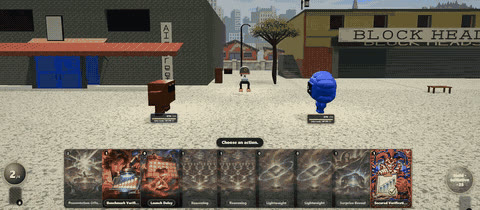
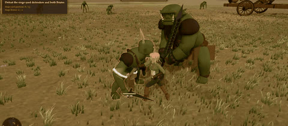
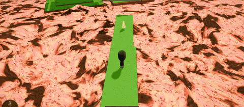
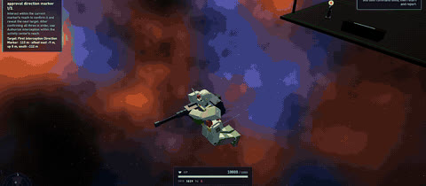
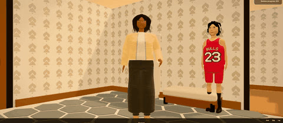
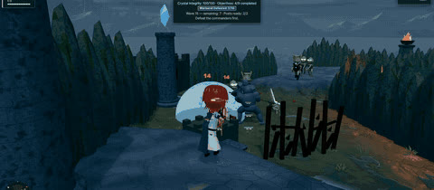
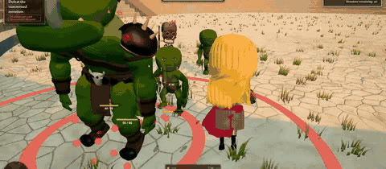
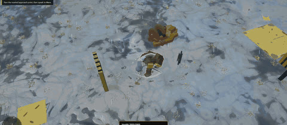

# ThreeMod

ThreeMod is an AI-native game engine built on Three.js for creating games and interactive content without writing code.

[Desktop downloads](https://github.com/Niceofer/ThreeMod/releases) · [Website](https://threemod.com) · [Community (Discord)](https://discord.gg/uAKu2QjtRP)

[한국어](./README_ko.md) · [日本語](./README_ja.md)

## See ThreeMod in action

| [The power to finish a game, even on your own](https://www.youtube.com/watch?v=r3GPCOFZn9w) | [What kinds of games can you create?](https://www.youtube.com/watch?v=pK_qjO2JL0A) |
| :---: | :---: |
|  |  |

[Explore all eight playable demos on the ThreeMod website](https://threemod.com/?lang=en#games)

## Download and install

Download and install the package for your operating system from [GitHub Releases](https://github.com/Niceofer/ThreeMod/releases).

- **Windows**: Run the Windows installer. See also the [Windows installation guide](./INSTALL_BYC_WINDOWS.md).
- **macOS**: Download the macOS package and install the app. Requires macOS 13 Ventura or later.
- **Linux (x64)**: Download the AppImage or `.deb` package. For AppImage, grant execute permission and run it; on Debian/Ubuntu, install the `.deb` package with your package manager. Linux packages are also distributed through GitHub Actions releases when the Linux build is enabled.

The desktop app is currently unsigned, so your operating system may display a security warning. On Windows, check **More info → Run anyway**. On macOS, use **right-click → Open** in Finder or check the option to allow the app in **System Settings → Privacy & Security**.

## Browser examples

Try content created with ThreeMod directly in your browser, without installing anything.

<table>
  <tr>
    <td width="50%" valign="top">
      <a href="https://share.threemod.com/byc_6c536d94e10343adb8a141cff570f990?node=N_LOGI1TO7-NX8XL2Z1"> <strong>Petaflop Duel</strong></a> 
      Action ? Strategy ? Turn-based &middot; <a href="./assets/demos/petaflop-duel.gif?raw=true">View GIF</a>
    </td>
    <td width="50%" valign="top">
      <a href="https://share.threemod.com/byc_6c536d94e10343adb8a141cff570f990?node=N_MLI3AJT1-ZK17KS6J"> <strong>Breaching the Black-Fang Fortress</strong></a> 
      Action &middot; <a href="./assets/demos/breaching-the-black-fang-fortress.gif?raw=true">View GIF</a>
    </td>
  </tr>
  <tr>
    <td width="50%" valign="top">
      <a href="https://share.threemod.com/byc_6c536d94e10343adb8a141cff570f990?node=N_08PRPK6Y-J5TQJ152"> <strong>Ascent of the Wild</strong></a> 
      Action ? Adventure ? Puzzle &middot; <a href="./assets/demos/ascent-of-the-wild.gif?raw=true">View GIF</a>
    </td>
    <td width="50%" valign="top">
      <a href="https://share.threemod.com/byc_6c536d94e10343adb8a141cff570f990?node=N_YFNFLMWH-1POD7KZ4"> <strong>Nebula Recovery Mission</strong></a> 
      Action &middot; <a href="./assets/demos/nebula-recovery-mission.gif?raw=true">View GIF</a>
    </td>
  </tr>
  <tr>
    <td width="50%" valign="top">
      <a href="https://share.threemod.com/byc_6c536d94e10343adb8a141cff570f990?node=N_U50BL5HY-06UEZ5PS"> <strong>A Home Takes Shape</strong></a> 
      Interactive Story ? Simulation ? Slice of Life &middot; <a href="./assets/demos/a-home-takes-shape.gif?raw=true">View GIF</a>
    </td>
    <td width="50%" valign="top">
      <a href="https://share.threemod.com/byc_6c536d94e10343adb8a141cff570f990?node=N_0KMAK7ZW-ZMCWVR7B"> <strong>Last Stand Against Darkness</strong></a> 
      Action ? Strategy ? Fantasy &middot; <a href="./assets/demos/last-stand-against-darkness.gif?raw=true">View GIF</a>
    </td>
  </tr>
  <tr>
    <td width="50%" valign="top">
      <a href="https://share.threemod.com/byc_6c536d94e10343adb8a141cff570f990?node=N_UGR5ZBG1-KM0W1FMZ"> <strong>Colossus of the Arena</strong></a> 
      Action ? Fantasy &middot; <a href="./assets/demos/colossus-of-the-arena.gif?raw=true">View GIF</a>
    </td>
    <td width="50%" valign="top">
      <a href="https://share.threemod.com/byc_6c536d94e10343adb8a141cff570f990?node=N_2L3I6QFJ-H6E2NU43"> <strong>Hammerfall Demolition Job</strong></a> 
      Destruction ? Action ? Survival &middot; <a href="./assets/demos/hammerfall-demolition-job.gif?raw=true">View GIF</a>
    </td>
  </tr>
</table>

## Repository layout

- **Root**: Introduction, installation instructions, and related materials for the ThreeMod desktop packages available in Releases
- **Player source**: Distribution is currently in preparation.

## Publish your project

Self-hosting instructions for publishing your projects will be provided when the player source is released. Player source distribution is currently in preparation.

## Terms of use

[License](./LICENSE.md) · [EULA](./EULA.md) · [Third-party notices](./THIRD-PARTY-LICENSES.md)
