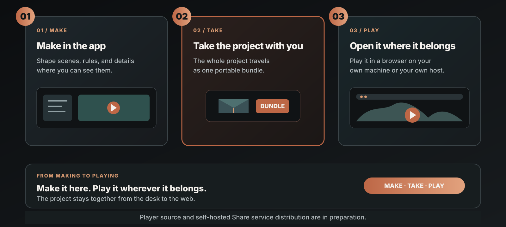

# ThreeMod

ThreeMod is an AI-native game engine built on Three.js for creating games and interactive content without writing code.

[Desktop downloads](https://github.com/Niceofer/ThreeMod/releases) · [Website](https://threemod.com) · [Discord](https://discord.gg/aFjbNBh6)

[한국어](./README_ko.md) · [日本語](./README_ja.md)

## Download and install

Download and install the package for your operating system from [GitHub Releases](https://github.com/Niceofer/ThreeMod/releases).

- **Windows**: Run the Windows installer. See also the [Windows installation guide](./INSTALL_BYC_WINDOWS.md).
- **macOS**: Download the macOS package and install the app. Requires macOS 13 Ventura or later.
- **Linux (x64)**: Download the AppImage or `.deb` package. For AppImage, grant execute permission and run it; on Debian/Ubuntu, install the `.deb` package with your package manager. Linux packages are also distributed through GitHub Actions releases when the Linux build is enabled.

The desktop app is currently unsigned, so your operating system may display a security warning. On Windows, check **More info → Run anyway**. On macOS, use **right-click → Open** in Finder or check the option to allow the app in **System Settings → Privacy & Security**.

## Create and play projects

1. **Create a project bundle**: Create and edit your project in the ThreeMod desktop app, then select **Export bundle → Export to folder** in the project details panel to export the project data and required assets.

2. **Player source — in preparation**: Once released, the separately distributed player source will let you run your bundle in a web browser. The source is for running projects; the full editor source is not included. **Player source distribution is currently in preparation.**

3. **Self-hosting — after the player source is released**: Once the player source is released, you will be able to deploy it with your bundle to your own server. Installation, startup, and self-hosting instructions will be provided when the player source is released.

## Browser examples

Try content created with ThreeMod directly in your browser, without installing anything.

- [Life Simulation](https://share.threemod.com/byc_f8b97ef4c16045149399d27014556e48)
- [Interaction](https://share.threemod.com/byc_b0cc670cf88f4838b6e1abd80e7755d5)

## Repository layout

- **Root**: Introduction, installation instructions, and related materials for the ThreeMod desktop packages available in Releases
- **Player source**: Distribution is currently in preparation.

## Publish your project

Self-hosting instructions for publishing your projects will be provided when the player source is released. Player source distribution is currently in preparation.

## Terms of use

[License](./LICENSE.md) · [EULA](./EULA.md) · [Third-party notices](./THIRD-PARTY-LICENSES.md)
