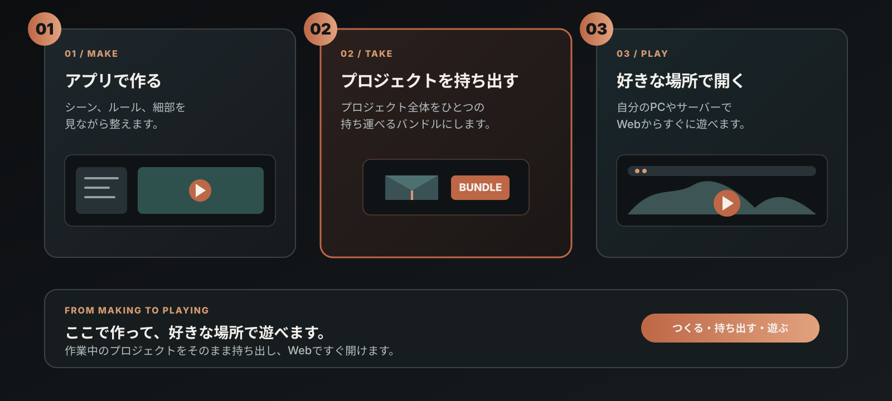

# ThreeMod

ThreeMod は、コードを書かずにゲームやインタラクティブコンテンツを制作できる AI ネイティブのゲームエンジンです。デスクトップアプリでプロジェクトを作成し、バンドルとして書き出してウェブブラウザーでプレイできます。

[デスクトップ版のダウンロード](https://github.com/Niceofer/ThreeMod/releases) · [ウェブサイト](https://threemod.com) · [Discord](https://discord.gg/aFjbNBh6)

[English](./README.md) · [한국어](./README_ko.md)

## ダウンロードとインストール

[GitHub Releases](https://github.com/Niceofer/ThreeMod/releases) から、お使いの OS に対応するパッケージをダウンロードしてインストールしてください。

- **Windows**: Windows 用インストーラーを実行します。[Windows インストールガイド](./INSTALL_BYC_WINDOWS.md)も参照してください。
- **macOS**: macOS 用パッケージをダウンロードしてアプリをインストールします。macOS 13 Ventura 以降が必要です。

現在、デスクトップアプリにはコード署名がないため、実行時に OS のセキュリティ警告が表示される場合があります。Windows では **詳細情報 → 実行**、macOS では Finder の **右クリック → 開く**、または **システム設定 → プライバシーとセキュリティ**の実行許可項目を確認してください。

## プロジェクトの制作とプレイ

ThreeMod デスクトップアプリでプロジェクトを作成・編集します。プロジェクトの詳細パネルで **バンドルのエクスポート → フォルダーにエクスポート**を選択すると、プロジェクトデータと必要なアセットを書き出せます。

プレイ用ソースの配布は現在準備中です。書き出したバンドルをローカルのウェブブラウザーで実行するためのインストール・起動手順は、ソースの配布時に公開する予定です。

## ブラウザーでの実行例

ThreeMod で制作したコンテンツを、インストールせずにブラウザーでお試しください。

- [Life Simulation](https://share.threemod.com/byc_f8b97ef4c16045149399d27014556e48)
- [Interaction](https://share.threemod.com/byc_b0cc670cf88f4838b6e1abd80e7755d5)

## リポジトリ構成

- **ルート**: Releases で配布される ThreeMod デスクトップパッケージの紹介、インストール案内、関連資料
- **プレイ用ソース**: 現在配布準備中です。

## 公開する

プロジェクトを自分のサーバーで公開する手順は、プレイ用ソースの配布時に案内する予定です。プレイ用ソースの配布は現在準備中です。

## 利用条件

[ライセンス](./LICENSE.md) · [EULA（英語）](./EULA.md) · [サードパーティーに関する通知](./THIRD-PARTY-LICENSES.md)
