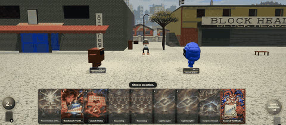
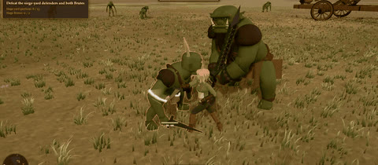
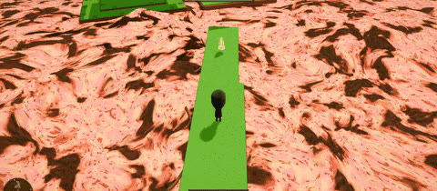
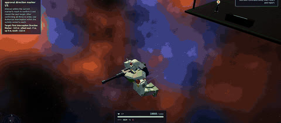
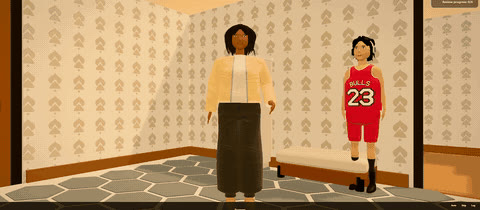
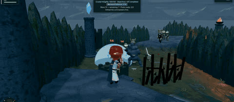
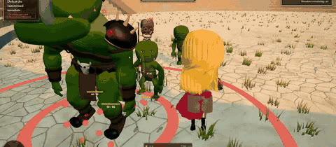
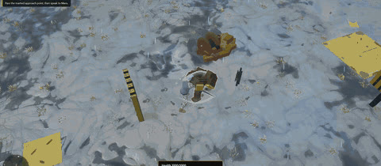

# ThreeMod

ThreeMod는 Three.js 기반의 AI 네이티브 게임 엔진으로, 코드 없이 게임과 인터랙티브 콘텐츠를 만들 수 있습니다.

[데스크톱 다운로드](https://github.com/Niceofer/ThreeMod/releases) · [웹사이트](https://threemod.com) · [커뮤니티 (Discord)](https://discord.gg/uAKu2QjtRP)

[English](./README.md) · [日本語](./README_ja.md)

## 영상으로 만나는 ThreeMod

| [혼자서도, 게임 하나를 완성하는 힘](https://www.youtube.com/watch?v=r3GPCOFZn9w) | [어떤 게임을 만들 수 있나요?](https://www.youtube.com/watch?v=pK_qjO2JL0A) |
| :---: | :---: |
|  |  |

[ThreeMod 홈페이지에서 8종의 게임 데모를 직접 플레이해 보세요](https://threemod.com/?lang=ko#games)

## 다운로드 및 설치

[GitHub Releases](https://github.com/Niceofer/ThreeMod/releases)에서 운영체제에 맞는 패키지를 내려받아 설치하세요.

- **Windows**: Windows용 설치 패키지를 실행합니다. [Windows 설치 안내](./INSTALL_BYC_WINDOWS.md)도 참고하세요.
- **macOS**: macOS용 패키지를 내려받아 앱을 설치합니다. macOS 13 Ventura 이상이 필요합니다.
- **Linux (x64)**: AppImage 또는 `.deb` 패키지를 내려받습니다. AppImage는 실행 권한을 부여한 뒤 실행하고, Debian/Ubuntu에서는 패키지 관리자로 `.deb` 패키지를 설치합니다. GitHub Actions 배포 시 Linux 빌드를 포함하면 Linux용 패키지도 함께 배포됩니다.

현재 데스크톱 앱은 코드 서명이 되어 있지 않아 실행 시 운영체제의 보안 경고가 표시될 수 있습니다. Windows에서는 **추가 정보 → 실행**, macOS에서는 Finder의 **우클릭 → 열기** 또는 **시스템 설정 → 개인정보 보호 및 보안**의 실행 허용 항목을 확인하세요.

## 브라우저 실행 예시

ThreeMod로 만든 콘텐츠를 설치 없이 브라우저에서 실행해 보세요.

<table>
  <tr>
    <td width="50%" valign="top">
      <a href="https://share.threemod.com/byc_6c536d94e10343adb8a141cff570f990?node=N_LOGI1TO7-NX8XL2Z1"> <strong>연산력을 건 맞대결</strong></a> 
      액션 / 전략 / 턴제 &middot; <a href="./assets/demos/petaflop-duel.gif?raw=true">GIF 보기</a>
    </td>
    <td width="50%" valign="top">
      <a href="https://share.threemod.com/byc_6c536d94e10343adb8a141cff570f990?node=N_MLI3AJT1-ZK17KS6J"> <strong>검은 이빨 요새 돌파</strong></a> 
      액션 &middot; <a href="./assets/demos/breaching-the-black-fang-fortress.gif?raw=true">GIF 보기</a>
    </td>
  </tr>
  <tr>
    <td width="50%" valign="top">
      <a href="https://share.threemod.com/byc_6c536d94e10343adb8a141cff570f990?node=N_08PRPK6Y-J5TQJ152"> <strong>야생의 정상</strong></a> 
      액션 / 어드벤처 / 퍼즐 &middot; <a href="./assets/demos/ascent-of-the-wild.gif?raw=true">GIF 보기</a>
    </td>
    <td width="50%" valign="top">
      <a href="https://share.threemod.com/byc_6c536d94e10343adb8a141cff570f990?node=N_YFNFLMWH-1POD7KZ4"> <strong>성운 회복 임무</strong></a> 
      액션 &middot; <a href="./assets/demos/nebula-recovery-mission.gif?raw=true">GIF 보기</a>
    </td>
  </tr>
  <tr>
    <td width="50%" valign="top">
      <a href="https://share.threemod.com/byc_6c536d94e10343adb8a141cff570f990?node=N_U50BL5HY-06UEZ5PS"> <strong>집의 모습이 갖춰지다</strong></a> 
      인터랙티브 스토리 / 시뮬레이션 / 일상 &middot; <a href="./assets/demos/a-home-takes-shape.gif?raw=true">GIF 보기</a>
    </td>
    <td width="50%" valign="top">
      <a href="https://share.threemod.com/byc_6c536d94e10343adb8a141cff570f990?node=N_0KMAK7ZW-ZMCWVR7B"> <strong>어둠에 맞선 최후의 저항</strong></a> 
      액션 / 전략 / 판타지 &middot; <a href="./assets/demos/last-stand-against-darkness.gif?raw=true">GIF 보기</a>
    </td>
  </tr>
  <tr>
    <td width="50%" valign="top">
      <a href="https://share.threemod.com/byc_6c536d94e10343adb8a141cff570f990?node=N_UGR5ZBG1-KM0W1FMZ"> <strong>투기장의 거상</strong></a> 
      액션 / 판타지 &middot; <a href="./assets/demos/colossus-of-the-arena.gif?raw=true">GIF 보기</a>
    </td>
    <td width="50%" valign="top">
      <a href="https://share.threemod.com/byc_6c536d94e10343adb8a141cff570f990?node=N_2L3I6QFJ-H6E2NU43"> <strong>해머폴 철거 작업</strong></a> 
      파괴 / 액션 / 생존 &middot; <a href="./assets/demos/hammerfall-demolition-job.gif?raw=true">GIF 보기</a>
    </td>
  </tr>
</table>

## 저장소 구성

- **루트**: Releases에 등록된 ThreeMod 데스크톱 패키지의 소개, 설치 안내와 관련 자료
- **플레이용 소스**: 현재 배포 준비 중입니다.

## 서비스하기

프로젝트를 직접 서버에 올려 공개하는 방법은 플레이용 소스 배포 시 안내할 예정입니다. 플레이용 소스 배포는 현재 준비 중입니다.

## 이용 조건

[라이선스](./LICENSE.md) · [EULA](./EULA_ko.md) · [서드파티 고지](./THIRD-PARTY-LICENSES.md)
