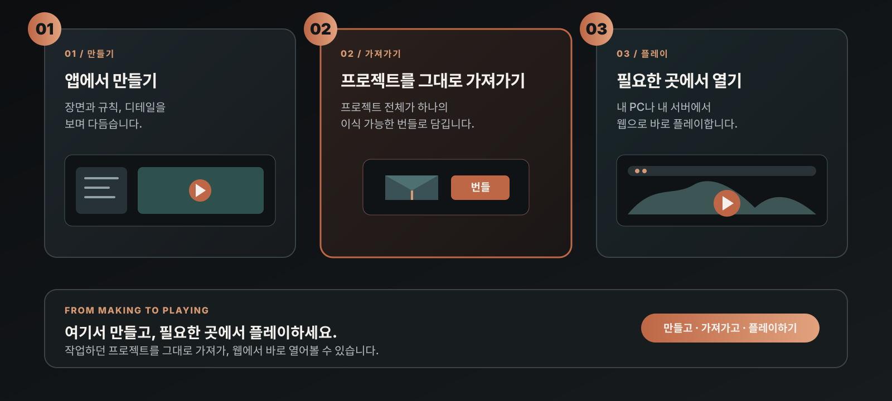

# ThreeMod

ThreeMod는 코드 없이 게임과 인터랙티브 콘텐츠를 만드는 AI 네이티브 게임 엔진입니다. 데스크톱 앱에서 프로젝트를 만들고, 번들로 내보내 웹브라우저에서 플레이할 수 있습니다.

[데스크톱 다운로드](https://github.com/Niceofer/ThreeMod/releases) · [웹사이트](https://threemod.com) · [Discord](https://discord.gg/aFjbNBh6)

[English](./README.md) · [日本語](./README_ja.md)

## 다운로드 및 설치

[GitHub Releases](https://github.com/Niceofer/ThreeMod/releases)에서 운영체제에 맞는 패키지를 내려받아 설치하세요.

- **Windows**: Windows용 설치 패키지를 실행합니다. [Windows 설치 안내](./INSTALL_BYC_WINDOWS.md)도 참고하세요.
- **macOS**: macOS용 패키지를 내려받아 앱을 설치합니다. macOS 13 Ventura 이상이 필요합니다.
- **Linux (x64)**: AppImage 또는 `.deb` 패키지를 내려받습니다. AppImage는 실행 권한을 부여한 뒤 실행하고, Debian/Ubuntu에서는 패키지 관리자로 `.deb` 패키지를 설치합니다. GitHub Actions 배포 시 Linux 빌드를 포함하면 Linux용 패키지도 함께 배포됩니다.

현재 데스크톱 앱은 코드 서명이 되어 있지 않아 실행 시 운영체제의 보안 경고가 표시될 수 있습니다. Windows에서는 **추가 정보 → 실행**, macOS에서는 Finder의 **우클릭 → 열기** 또는 **시스템 설정 → 개인정보 보호 및 보안**의 실행 허용 항목을 확인하세요.

## 프로젝트 제작과 플레이

ThreeMod 데스크톱 앱에서 프로젝트를 만들고 편집합니다. 프로젝트 상세 패널의 **번들 내보내기 → 폴더로 내보내기**로 프로젝트 데이터와 필요한 에셋을 내보낼 수 있습니다.

플레이용 소스 배포는 현재 준비 중입니다. 내보낸 번들을 로컬 웹브라우저에서 실행하는 데 필요한 설치 및 실행 안내는 소스 배포 시 제공할 예정입니다.

## 브라우저 실행 예시

ThreeMod로 만든 콘텐츠를 설치 없이 브라우저에서 실행해 보세요.

- [Life Simulation](https://share.threemod.com/byc_f8b97ef4c16045149399d27014556e48)
- [Interaction](https://share.threemod.com/byc_b0cc670cf88f4838b6e1abd80e7755d5)

## 저장소 구성

- **루트**: Releases에 등록된 ThreeMod 데스크톱 패키지의 소개, 설치 안내와 관련 자료
- **플레이용 소스**: 현재 배포 준비 중입니다.

## 서비스하기

프로젝트를 직접 서버에 올려 공개하는 방법은 플레이용 소스 배포 시 안내할 예정입니다. 플레이용 소스 배포는 현재 준비 중입니다.

## 이용 조건

[라이선스](./LICENSE.md) · [EULA](./EULA_ko.md) · [서드파티 고지](./THIRD-PARTY-LICENSES.md)
